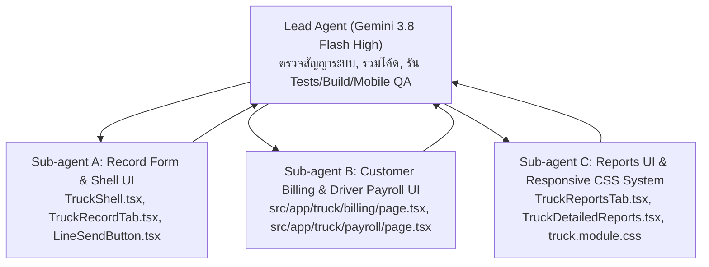

# แผนการรีดีไซน์ระบบรถบรรทุก (Truck UI/UX Redesign & Responsive Implementation Plan)

เอกสารฉบับนี้คือแผนปฏิบัติการฉบับละเอียดที่สุดสำหรับ **Gemini 3.8 Flash (High)** และทีม **Sub-agents** เพื่อดำเนินการปรับปรุง UI/UX, ตัดข้อความที่แปลกหรือซ้ำซ้อนออก, จัดระเบียบระยะห่างและสัดส่วนปุ่มกดให้สมมาตรทุกขนาดหน้าจอ, และปรับปรุงขั้นตอนการใช้งานของหน้า **วันทำงานและปิดรอบค่าแรง** (`/truck/payroll`), **วางบิลและรับเงิน** (`/truck/billing`), **บันทึกงาน** (`/truck`), และ **รายงานสรุป** (`/truck/reports`)

---

## 1. การตรวจสอบแผนเดิมและเช็คลิสต์เดิม (Conflict Resolution Matrix)

> [!IMPORTANT]
> **กฎสูงสุด**: หากข้อความในเอกสารเดิม ([TRUCK_IMPLEMENTATION_PLAN.md](file:///c:/Users/tleza/Documents/GitHub/pphitchaya/TRUCK_IMPLEMENTATION_PLAN.md), [TRUCK_SIMPLIFIED_PRICING_PLAN.md](file:///c:/Users/tleza/Documents/GitHub/pphitchaya/TRUCK_SIMPLIFIED_PRICING_PLAN.md), [TRUCK_REVISION_CHECKLIST.md](file:///c:/Users/tleza/Documents/GitHub/pphitchaya/TRUCK_REVISION_CHECKLIST.md), [TRUCK_MOBILE_QA.md](file:///c:/Users/tleza/Documents/GitHub/pphitchaya/TRUCK_MOBILE_QA.md)) ขัดแย้งกับตารางด้านล่างนี้ **ให้ยึดตามคำสั่งล่าสุดในเอกสารฉบับนี้ทั้งหมด**

| หัวข้อ | แผนเดิม / โค้ดปัจจุบัน | คำสั่งล่าสุด (ยึดตามนี้ 100%) | วิธีจัดการความขัดแย้ง |
|---|---|---|---|
| **1. เมนูและข้อความ "ตรวจข้อมูลที่ย้ายมาและราคาเดิม"** | แสดงปุ่ม `<a href="/truck/review">ตรวจข้อมูลที่ย้ายมา</a>` บนแถบเมนู `docNav` ใน `TruckShell.tsx` และแสดงกล่องแจ้งเตือนในหน้าบันทึกงาน/วางบิล/ค่าแรง | **ไม่ต้องแสดงบนหน้าเว็บปกติ**: ซ่อนปุ่มออกจากแถบ `docNav` และซ่อนแบนเนอร์แจ้งเตือนออกจากหน้าปกติ แต่**เก็บไฟล์ `/truck/review/page.tsx` และ API `/api/truck/trips` ไว้ในโค้ด**เผื่อเข้าผ่าน URL ตรง | ลบลิงก์ `/truck/review` ออกจาก `TruckShell.tsx` เหลือเพียง 2 ปุ่มคู่กัน (`วันทำงานและปิดรอบค่าแรง` และ `วางบิลและรับเงิน`) และซ่อนข้อความเตือน legacy review ใน UI ปกติ |
| **2. หน้าวางบิลและรับเงิน (`/truck/billing`)** | เลือกเฉพาะเดือน แล้วแสดง checkbox รายการเที่ยวของทุกลูกค้าปนกัน ใช้ `window.prompt()` เด้งถามวันที่ออกบิล/วันครบกำหนด/ยอดรับเงิน | **เลือกเป็นรายลูกค้า**: เลือก `เดือน` + เลือก `ลูกค้า` → แสดงเฉพาะเที่ยววิ่งของลูกค้ารายนั้น (วันที่ออก, ทะเบียนรถ, ต้นทาง→ปลายทาง, น้ำหนัก, ยอดเงิน) มีปุ่ม "เลือกทั้งหมด" และช่องกรอกวันที่ออกบิล/วันครบกำหนด/ฟอร์มรับชำระเงินบนหน้าจอ (เลิกใช้ `window.prompt`) | ปรับ UI หน้า `/truck/billing` ให้มีตัวกรองลูกค้า (Customer Select) คู่กับเดือน เมื่อเลือกลูกค้าจะกรองทั้งรายการเที่ยวที่ยังไม่วางบิลและประวัติใบวางบิลของลูกค้ารายนั้น พร้อมฟอร์ม Inline/Modal แทน `prompt()` |
| **3. หน้าวันทำงานและปิดรอบค่าแรง (`/truck/payroll`)** | แสดงรายชื่อคนขับทุกคนเรียงต่อกันในหน้าเดียว ใช้ CSS ดิบแยกจาก Shell และใช้ `window.prompt()` ถามวันที่จ่าย/เหตุผล | **เลือกดูเป็นรายคน (แต่ละเดือน)**: เลือก `เดือน` + เลือก `คนขับ` → แสดงข้อมูลของคนขับคนนั้นอย่างชัดเจน (วันทำงานที่ได้ค่าแรงฐาน + รายการเที่ยววิ่งแต่ละเที่ยวในเดือนนั้น + สรุปยอดค่าแรงฐาน/ค่าเที่ยว/รวมสุทธิ) พร้อมส่วนติ๊กยืนยันวันทำงานและปุ่มปิดรอบ/บันทึกจ่าย/ดาวน์โหลด PDF บนหน้าจอโดยไม่ใช้ `prompt()` | ปรับ UI หน้า `/truck/payroll` ให้มี Dropdown เลือกคนขับ ดูรายละเอียดรายคนในแต่ละเดือนว่าได้ค่าแรงฐานวันไหนบ้างและวิ่งเที่ยวไหนบ้าง พร้อมฟอร์มบันทึกวันจ่าย/เปิดรอบบนหน้าจอ |
| **4. ตัวเลือก "เรียกเก็บลูกค้า (ปิดสำหรับเที่ยวกลับอู่/รถเปล่า)" ในหน้าบันทึกงาน** | แสดง Checkbox `<label><input type="checkbox" ... /> เรียกเก็บลูกค้า (ปิดสำหรับเที่ยวกลับอู่/รถเปล่า)</label>` แยกต่างหากเหนือช่องเลือกลูกค้า | **ตัด Checkbox นี้ออก**: ใช้ช่อง `ลูกค้า` เป็นตัวกำหนดแทน โดยตัวเลือกแรกคือ `"ไม่เรียกเก็บลูกค้า / รถเปล่า"` หากเลือกตัวเลือกนี้ ระบบจะตั้ง `billable: false` และซ่อน/ปิดช่องราคาขนส่งเหมาอัตโนมัติ หากเลือกลูกค้า ระบบจะตั้ง `billable: true` | ลบ Checkbox ออกจาก `TruckRecordTab.tsx` และผูกค่า `billable = Boolean(t.customerId)` เข้ากับการเลือกลูกค้าโดยตรง (ส่ง payload `billable` ไปยัง API ตามเดิมเพื่อไม่ให้ Backend พัง) |
| **5. ตำแหน่งปุ่ม "ยกเลิกเที่ยว" ในหน้าบันทึกงาน** | อยู่บนหัวการ์ด `tripHead` เบียดกับคำว่า `เที่ยวที่ 1` และปุ่มถังขยะ | **ย้ายลงมาด้านล่างของแต่ละเที่ยว**: อยู่ด้านล่างของฟอร์มเที่ยว (เหนือปุ่ม `+ เพิ่มเที่ยววิ่งที่ 2`) จัดสัดส่วนเป็นแถวตัวเลือก/ปุ่มที่ชัดเจน ไม่เบียดหัวข้อ `เที่ยวที่ 1` | ย้าย Checkbox/Toggle `ยกเลิกเที่ยวนี้` จาก `.tripHead` ลงมาไว้ท้ายบล็อก `.trip` เหนือปุ่ม `.addBtn` |
| **6. ปุ่มด้านล่างหน้าบันทึกงาน (`บันทึกใบงาน` + `ส่งสรุปวันนี้เข้า LINE`)** | `LineSendButton` มี `<div>` ห่อหุ้มและมี `<div role="status" style={{ minHeight: '1.5rem' }}>` อยู่ข้างใน ทำให้ความสูงใน Grid 2 คอลัมน์ไม่เท่ากับปุ่ม `บันทึกใบงาน` (ดูเยื้องกัน) | **จัดสัดส่วนและความสูงให้เท่ากันเป๊ะ**: ทั้งสองปุ่มต้องมีความสูง (`min-height: var(--team-btn-height)`) ขอบ และแนวระนาบเดียวกันเป๊ะ ไม่เยื้องกันทั้งบนมือถือและเดสก์ท็อป | ปรับโครงสร้าง `LineSendButton.tsx` และ `.actions` ใน `truck.module.css` ให้ปุ่มทั้งสองวางอยู่ในระนาบเดียวกัน และแสดงข้อความสถานะด้านล่างแถวปุ่มอย่างเป็นระเบียบ |
| **7. ปุ่ม 4 ปุ่มในหน้ารายงานสรุป (`/truck/reports`)** | ปุ่ม `ดาวน์โหลด PDF`, `ส่งออก Excel (CSV)`, `รายงานละเอียดและกราฟ` อยู่ใน `.toolbar` (`flex: 1 1 11rem`) ส่วน `ส่งสรุปวันนี้เข้า LINE` หลุดออกมาอยู่นอก `.toolbar` ด้านล่าง ทำให้ขนาดและระยะห่างไม่เท่ากัน | **รวมทั้ง 4 ปุ่มใน Grid เดียวกัน**: จัดเป็น **Grid 2×2** บนจอแท็บเล็ต/คอมพิวเตอร์ (`>= 640px`) และเรียง **1 คอลัมน์เต็มความกว้าง** บนจอมือถือ (`< 640px`) ทุกปุ่มสูงเท่ากันและระยะห่างเท่ากันทั้งหมด | นำ `LineSendButton` เข้าไปอยู่ใน `.reportActionsGrid` เดียวกับอีก 3 ปุ่มใน `TruckReportsTab.tsx` |
| **8. การตัดคำแปลกๆ (Awkward Wording Cleanup)** | มีข้อความทางเทคนิคและคำแปลกๆ เช่น `"ตรวจข้อมูลที่ย้ายมา"`, `"เรียกเก็บลูกค้า (ปิดสำหรับเที่ยวกลับอู่/รถเปล่า)"`, `"รายงานงานรถสิบล้อ"` (คำว่า "งาน" ซ้ำ), `"คำแนะนำจากเที่ยวที่ครอบคลุมวันนี้..."`, รหัส ID ดิบในหน้าแจ้งเตือน | **ใช้ภาษาไทยที่เข้าใจง่าย เป็นธรรมชาติ**: เช่น `"รายงานสรุปเที่ยววิ่ง"`, `"ไม่เรียกเก็บลูกค้า / รถเปล่า"`, `"มีรายชื่อแนะนำจากเที่ยววิ่งวันนี้"` | ตรวจสอบและเกลาข้อความ Label, Hint, Button, Heading ทุกจุดในโฟลเดอร์ `src/components/truck/` และ `src/app/truck/` |

---

## 2. ขอบเขตงานที่ชัดเจน: สิ่งที่ต้องทำ (DOs) และสิ่งที่ห้ามทำเด็ดขาด (DON'Ts)

### สิ่งที่ต้องทำ (DOs)
1. **Responsive Design ทุกอุปกรณ์ ทุกขนาด ทุกสัดส่วน**:
   - รองรับหน้าจอมือถือขนาดเล็ก (`320px`, `360px`, `375px`, `390px`), แท็บเล็ต (`768px`, `820px`), และหน้าจอคอมพิวเตอร์ (`1024px`, `1280px`, `1440px+`)
   - ใช้ CSS Grid และ Flexbox ที่มี `minmax(0, 1fr)` ป้องกันปัญหาข้อความดันกรอบล้นแนวนอน (`horizontal overflow = 0`)
   - ปุ่มกดและช่องกรอกข้อมูลทุกจุดต้องมีขนาด Touch Target อย่างน้อย `48px` (`min-height: 3rem` หรือ `var(--team-btn-height)`) และ `font-size: 16px` บนมือถือเพื่อป้องกัน iOS ซูมหน้าจอ
2. **ใช้ Design System เดียวกันทั้งระบบ (`TruckShell` / `truck.module.css`)**:
   - หน้า `/truck/payroll` และ `/truck/billing` ต้องใช้ Header/Container และ Card Panel (`.panel`, `.stack`, `.row2`, `.actionsGrid`) ที่เข้าชุดกับหน้า `/truck` อย่างสมบูรณ์ ไม่ใช้สไตล์ดิบแยกเดี่ยว
3. **แทนที่ `window.prompt()` ด้วย UI บนหน้าจอจริง**:
   - ในหน้า `/truck/billing` (ออกใบวางบิล, บันทึกรับเงิน, ยกเลิกบิล/รายการรับเงิน) และ `/truck/payroll` (บันทึกวันจ่าย, เปิดรอบแก้ไข, ยกเลิกบันทึกจ่าย) ต้องใช้ฟอร์มหรือ Modal บนหน้าจอแทน `window.prompt()` เพื่อให้ใช้งานบนมือถือได้สะดวกและสวยงาม
4. **อัปเดตสคริปต์ทดสอบมือถือ (`scripts/truck-mobile-qa.mjs`)**:
   - ปรับ selector ใน `scripts/truck-mobile-qa.mjs` ให้ตรงกับ UI ใหม่ และเพิ่มการตรวจสอบความสมมาตรของปุ่มกดและหน้าจอทุกขนาด

### สิ่งที่ห้ามทำเด็ดขาด (DON'Ts)
> [!CAUTION]
> 1. **ห้ามแก้สูตรคำนวณเงินหรือหน่วยสตางค์บนเซิร์ฟเวอร์**: ห้ามเปลี่ยน `pricingVersion: 3`, `billingPricingMode: 'PER_TRIP'`, ค่าแรงฐาน 300 บาท/วัน, หรือกติกาเดือนบัญชีตามวันออก (`departureDate`)
> 2. **ห้ามลบไฟล์ `/truck/review/page.tsx` หรือ API `/api/truck/trips`**: ให้ซ่อนเฉพาะปุ่มลิงก์บนเมนูหลักและแบนเนอร์รบกวนสายตาเท่านั้น แต่ตัวหน้าและ API ต้องยังอยู่ครบและผ่านชุดทดสอบ `tests/truck-routes.test.ts`
> 3. **ห้ามใส่ลิงก์ข้ามไปเว็บเช็คชื่อ (`/` หรือ `/attendance`)**: ระบบรถบรรทุกต้องแยกขาดจากระบบเช็คชื่อ 100%
> 4. **ห้ามใช้ Emoji แม้แต่ตัวเดียว (Zero Emoji Rule)**: ใช้เฉพาะ SVG Icon จาก `lucide-react` เท่านั้น
> 5. **ห้ามทำให้ Backend Tests เดิมพัง**: ชุดทดสอบ `npm.cmd test` ทั้ง 166 ข้อต้องผ่าน 100% เหมือนเดิม

---

## 3. รายละเอียดการออกแบบและแก้ไขรายไฟล์ (Proposed Changes)

### ส่วนที่ 1: ระบบ CSS Layout & Responsive Tokens (`src/components/truck/truck.module.css` & `src/components/shared/LineSendButton.tsx`)

#### [MODIFY] [LineSendButton.tsx](file:///c:/Users/tleza/Documents/GitHub/pphitchaya/src/components/shared/LineSendButton.tsx)
- **ปัญหาเดิม**: `LineSendButton` คืนค่า `<div><button>...</button><div role="status" style={{ minHeight: '1.5rem' }}>...</div></div>` ทำให้เมื่อนำไปวางคู่กับปุ่มอื่นใน Grid มีความสูงส่วนเกิน `1.5rem` ด้านล่าง ทำให้ปุ่มดูเยื้องและไม่สมดุล
- **การแก้ไข**:
  - ให้คอมโพเนนต์จัดวาง `<div className={styles.lineActionWrap}>` ที่ให้ `<button>` มี `width: 100%; height: 100%; min-height: var(--team-btn-height)` และแสดงข้อความ `status` เฉพาะเมื่อมีข้อความ (`status?.text`) หรือจัดวางให้ไม่ดันความสูงปุ่มข้างเคียงเสียสมดุล

#### [MODIFY] [truck.module.css](file:///c:/Users/tleza/Documents/GitHub/pphitchaya/src/components/truck/truck.module.css)
- ปรับปรุงและเพิ่มคลาสสำหรับการจัดวางทุกขนาดหน้าจอ:
  - `.docNav`: จัดเป็น Grid 2 คอลัมน์บนแท็บเล็ต/เดสก์ท็อป (`grid-template-columns: repeat(2, minmax(0, 1fr))`) และบนมือถือเรียงสวยงามเต็มความกว้าง มีไอคอนและระยะห่างชัดเจน
  - `.tripFooter`: แถวด้านล่างของแต่ละเที่ยวสำหรับวางตัวเลือก `ยกเลิกเที่ยวนี้` และปุ่ม `ลบเที่ยว` ให้แยกออกจากหัวข้อ `เที่ยวที่ 1` อย่างเป็นระเบียบ
  - `.actionsGrid2`: Grid สำหรับปุ่มคู่ (`บันทึกใบงาน` + `ส่งสรุปวันนี้เข้า LINE`) ที่บังคับ `align-items: stretch` บนจอ `>= 640px` เป็น `grid-template-columns: repeat(2, minmax(0, 1fr))` และบนจอมือถือ `< 640px` เป็น `grid-template-columns: minmax(0, 1fr)` พร้อม `gap: 0.75rem`
  - `.reportActionsGrid`: Grid สำหรับปุ่ม 4 ปุ่มในหน้ารายงาน (`ดาวน์โหลด PDF`, `ส่งออก Excel (CSV)`, `รายงานละเอียดและกราฟ`, `ส่งสรุปวันนี้เข้า LINE`) บนจอ `< 640px` เรียง 1 คอลัมน์เต็มความกว้าง และบนจอ `>= 640px` จัดเป็น **Grid 2×2** (`grid-template-columns: repeat(2, minmax(0, 1fr)); gap: 0.75rem`) ทุกปุ่มมีความสูง `min-height: var(--team-btn-height)` เท่ากันเป๊ะ
  - `.subpageShell`: คอนเทนเนอร์มาตรฐานสำหรับหน้า `/truck/payroll` และ `/truck/billing` ที่มี Header แถบนำทางกลับหน้าหลัก, Card Panel (`.panel`), ตาราง/รายการที่อ่านง่ายบนมือถือและเดสก์ท็อป

---

### ส่วนที่ 2: แถบเมนูหลักและหน้าบันทึกงาน (`src/components/truck/TruckShell.tsx` & `src/components/truck/TruckRecordTab.tsx`)

#### [MODIFY] [TruckShell.tsx](file:///c:/Users/tleza/Documents/GitHub/pphitchaya/src/components/truck/TruckShell.tsx)
- ใน `<nav className={truckStyles.docNav} aria-label="เอกสารรถบรรทุก">`:
  - **ตัดลิงก์ `<a href="/truck/review">ตรวจข้อมูลที่ย้ายมา</a>` ออก**
  - เหลือเฉพาะ 2 ปุ่มหลักที่จัดสัดส่วนสวยงามคู่กัน:
    1. `<a href="/truck/payroll">วันทำงานและปิดรอบค่าแรง</a>`
    2. `<a href="/truck/billing">วางบิลและรับเงิน</a>`

#### [MODIFY] [TruckRecordTab.tsx](file:///c:/Users/tleza/Documents/GitHub/pphitchaya/src/components/truck/TruckRecordTab.tsx)
1. **ตัดคำแปลกๆ และซ่อนข้อความตรวจข้อมูลเก่า**:
   - ซ่อนแบนเนอร์ `ใบงานนี้ยังไม่ผ่านการตรวจราคาแบบใหม่...` จากหน้าปกติ
   - ปรับข้อความ Hint วันที่ให้กระชับ: `{formatThaiDate(date)} · รอบบัญชีเดือน {date.slice(0, 7)}`
2. **ตัด Checkbox `"เรียกเก็บลูกค้า (ปิดสำหรับเที่ยวกลับอู่/รถเปล่า)"` ออก**:
   - ลบ `<label><input type="checkbox" checked={t.billable} ... /> เรียกเก็บลูกค้า (ปิดสำหรับเที่ยวกลับอู่/รถเปล่า)</label>`
   - ใช้ `<select id="tr-customer-${i}">` ช่อง **ลูกค้า** เป็นตัวกำหนดแทน:
     - ตัวเลือกแรก (`value=""`): `"ไม่เรียกเก็บลูกค้า / รถเปล่า"`
     - เมื่อเลือก `value=""` → ตั้งค่า `billable: false`, `customerId: ''`, `customer: ''`, `billing: ''`
     - เมื่อเลือกลูกค้า (`value !== ""`) → ตั้งค่า `billable: true`, `customerId`, `customer` และดึงราคาเหมาต่อเที่ยวตามคู่เส้นทางของลูกค้ารายนั้นอัตโนมัติ
   - ช่อง **ราคาขนส่งเหมาต่อเที่ยว (บาท)**: ถ้าไม่ได้เลือกลูกค้า (`!t.customerId`) ให้ `disabled` หรือแสดงข้อความชัดเจนว่า `"ไม่เรียกเก็บเงิน (รถเปล่า/ไม่ได้เลือกลูกค้า)"`
3. **ย้ายคำว่า `"ยกเลิกเที่ยว"` ลงมาใกล้ๆ / เหนือปุ่ม `"เพิ่มเที่ยววิ่งที่ 2"`**:
   - ใน `.tripHead` ด้านบนสุดของเที่ยว: แสดงเฉพาะชื่อ `เที่ยวที่ {i + 1}` (และสถานะถ้ามี)
   - ด้านล่างสุดของการ์ดแต่ละเที่ยว (ใต้ช่องหมายเหตุ และอยู่เหนือปุ่ม `+ เพิ่มเที่ยววิ่งที่ 2`): สร้างแถว `.tripFooter` ที่มีตัวเลือก `<label className={styles.cancelTripToggle}><input type="checkbox" checked={t.cancelled} ... /> ยกเลิกเที่ยวที่ {i + 1}</label>` คู่กับปุ่มลบเที่ยว (กรณีมีมากกว่า 1 เที่ยว)
4. **จัดสัดส่วนปุ่มด้านล่าง (`บันทึกใบงาน` และ `ส่งสรุปวันนี้เข้า LINE`)**:
   - วางใน `<div className={styles.actionsGrid2}>` ให้ปุ่มทั้งสองมีความสูง ระยะห่าง และความกว้างสมดุลกัน 100%

---

### ส่วนที่ 3: หน้าวางบิลและรับเงิน — เลือกตามลูกค้า (`src/app/truck/billing/page.tsx`)

#### [MODIFY] [page.tsx](file:///c:/Users/tleza/Documents/GitHub/pphitchaya/src/app/truck/billing/page.tsx)
ออกแบบหน้า `/truck/billing` ใหม่ให้ใช้ Design System เดียวกับ `TruckShell` และทำงานแบบ **เลือกเป็นลูกค้า**:
1. **ส่วนหัวและการเลือกข้อมูล (Filter Bar)**:
   - ปุ่มกลับหน้าหลัก (`/truck`) และปุ่มสลับไปหน้าค่าแรง (`/truck/payroll`)
   - แถวตัวเลือก 2 ช่องคู่กัน (`.row2`):
     1. **เดือนงาน** (`<input type="month">`)
     2. **เลือกลูกค้า** (`<select id="billing-customer">`): ดึงรายชื่อลูกค้าจาก `/api/truck/settings` (`truckCustomers`) พร้อมแสดงจำนวนเที่ยวที่รอวางบิลของลูกค้าแต่ละราย เช่น `"บริษัท ลูกค้าทดสอบ (รอวางบิล 3 เที่ยว)"` และตัวเลือก `"ดูลูกค้าทั้งหมด"`
2. **ส่วนที่ 1: รายการเที่ยววิ่งรอวางบิลของลูกค้าที่เลือก**:
   - แสดงเฉพาะเที่ยวของลูกค้าที่เลือก (บอกว่าลูกค้าคนนี้ มีรถทะเบียนอะไรวิ่งไปหาที่ไหน วันไหน น้ำหนักเท่าไหร่ ยอดเงินเท่าไหร่)
   - มีปุ่ม **"เลือกทั้งหมดของลูกค้านี้"** / **"ล้างที่เลือก"**
   - แสดงรายการเที่ยวเป็นการ์ด/แถวที่กดติ๊กง่ายบนมือถือ แสดง:
     - วันที่รถออก (`departureDate`) · ทะเบียนรถ (`plateNumberSnapshot`)
     - เส้นทาง (`fromLocation` → `destinationName`) · น้ำหนัก (`formatWeightTons(weightKg)` ตัน)
     - จำนวนเงิน (`formatMoney(billingSatang)` บาท)
   - **ฟอร์มออกใบวางบิลบนหน้าจอ (แทน `window.prompt`)**:
     - ช่องกรอก `วันที่ออกใบวางบิล` (ค่าเริ่มต้น = วันนี้) และ `วันครบกำหนดชำระ` (ค่าเริ่มต้น = วันนี้)
     - ช่องกรอก `หมายเหตุใบวางบิล`
     - สรุปจำนวนเที่ยวที่เลือก และยอดรวมสุทธิ (บาท)
     - ปุ่ม **"ออกใบวางบิลให้ลูกค้านี้"** (ป้องกันการเลือกเที่ยวข้ามลูกค้าโดยอัตโนมัติ)
3. **ส่วนที่ 2: ประวัติใบวางบิลและการรับชำระเงิน (กรองตามลูกค้าที่เลือกได้)**:
   - แสดงการ์ดใบวางบิลแต่ละใบ: เลขที่เอกสาร (`documentNo`), ชื่อลูกค้า, วันออก/ครบกำหนด, ยอดรวม, รับแล้ว, คงค้าง
   - ปุ่มกดที่จัดระยะห่างสวยงาม:
     - **ดาวน์โหลดใบวางบิล PDF**
     - **บันทึกรับเงิน** (เปิดฟอร์ม Inline/Modal กรอกยอดรับชำระ, วันที่รับเงิน, ช่องทางโอน/เงินสด, เลขอ้างอิง, หมายเหตุ — ไม่ใช้ `window.prompt`)
     - **ยกเลิกใบวางบิล** (เปิดฟอร์มยืนยันพร้อมช่องกรอกเหตุผล — เฉพาะบิลที่ยังไม่มีการรับเงิน)
   - ประวัติการรับชำระเงินย่อยพร้อมปุ่มยกเลิกรายการรับเงินแบบกรอกเหตุผลบนหน้าจอ

---

### ส่วนที่ 4: หน้าวันทำงานและปิดรอบค่าแรง — เลือกตามคนขับ (`src/app/truck/payroll/page.tsx`)

#### [MODIFY] [page.tsx](file:///c:/Users/tleza/Documents/GitHub/pphitchaya/src/app/truck/payroll/page.tsx)
ออกแบบหน้า `/truck/payroll` ใหม่ให้เลือกดูและจัดการ **เป็นรายคนขับในแต่ละเดือน**:
1. **ส่วนหัวและตัวเลือกหลัก**:
   - ปุ่มกลับหน้าหลัก (`/truck`) และปุ่มไปหน้าวางบิล (`/truck/billing`)
   - แถวตัวเลือกคู่กัน (`.row2`):
     1. **เดือนงาน** (`<input type="month">`)
     2. **เลือกคนขับ** (`<select id="payroll-driver">`): เลือกคนขับที่ต้องการดูรายละเอียด (มีตัวเลือกคนขับแต่ละคน พร้อมสรุปยอดรวมข้างชื่อ และสามารถสลับดูแต่ละคนได้ทันที)
2. **ส่วนรายละเอียดรายคนขับประจำเดือน (`คนนี้ได้อะไรยังไงแต่ละเดือน`)**:
   - **การ์ดสรุปรายได้ของคนขับที่เลือกในเดือนนั้น**:
     - จำนวนวันทำงานที่ได้ค่าแรงฐาน (`X วัน`) = `formatMoney(baseSatang)` บาท
     - จำนวนเที่ยววิ่งที่เสร็จสมบูรณ์ (`Y เที่ยว`) = `formatMoney(tripSatang)` บาท
     - **รวมค่าแรงสุทธิเดือนนี้**: `formatMoney(totalSatang)` บาท
   - **รายการวันทำงานรายวันของคนขับนี้**:
     - แสดงวันที่ที่ยืนยันวันทำงานแล้วในเดือนนั้น พร้อมส่วนยืนยัน/เพิ่มวันทำงานประจำวัน (เลือกวันที่และติ๊กยืนยันวันทำงานของคนขับ)
   - **รายการเที่ยววิ่งแต่ละเที่ยวของคนขับนี้ในเดือนนั้น**:
     - แสดงทุกเที่ยวที่คนขับคนนี้วิ่งในเดือนนั้น: วันที่ออก–ถึง, ทะเบียนรถ, ต้นทาง → ปลายทาง, สถานะ (เสร็จแล้ว / ยังค้าง), และค่าเที่ยวที่ได้ในแต่ละเที่ยว
   - **ปุ่มดำเนินการสำหรับคนขับนี้ (เมื่อปิดรอบแล้ว)**:
     - ปุ่ม **ดาวน์โหลดสลิป/ใบสรุปค่าแรง PDF** ของคนขับคนนี้
     - ปุ่ม **บันทึกจ่ายเงิน** (ฟอร์มกรอกวันที่จ่ายจริงและหมายเหตุบนหน้าจอ แทน `window.prompt`) หรือ **ยกเลิกบันทึกจ่าย**
3. **ส่วนควบคุมการปิด/เปิดรอบประจำเดือน**:
   - แสดงสถานะรอบเดือน (`ยังเปิดรอบ` / `ปิดรอบแล้ว`)
   - แสดงรายการเที่ยวค้าง (ถ้ามี) ด้วยภาษาที่เข้าใจง่าย (ไม่โชว์รหัส ID ดิบ)
   - ปุ่ม **ปิดรอบค่าแรงประจำเดือน** และปุ่ม **เปิดรอบแก้ไข** (มีช่องกรอกเหตุผลบนหน้าจอ แทน `window.prompt`)

---

### ส่วนที่ 5: หน้ารายงานสรุป (`src/components/truck/TruckReportsTab.tsx`)

#### [MODIFY] [TruckReportsTab.tsx](file:///c:/Users/tleza/Documents/GitHub/pphitchaya/src/components/truck/TruckReportsTab.tsx)
1. **แก้หัวข้อที่คำซ้ำ**:
   - เปลี่ยนจาก `รายงานงานรถสิบล้อ` เป็น `รายงานสรุปเที่ยววิ่งรถสิบล้อ`
2. **จัดระเบียบปุ่มทั้ง 4 ปุ่มให้สมส่วนใน `.reportActionsGrid`**:
   - รวมปุ่มทั้ง 4 เข้าไว้ในคอนเทนเนอร์เดียวกัน:
     1. `ดาวน์โหลด PDF` (`FileDown` icon)
     2. `ส่งออก Excel (CSV)` (`FileSpreadsheet` icon)
     3. `รายละเอียดและกราฟ` (`ChartNoAxesCombined` icon)
     4. `ส่งสรุปวันนี้เข้า LINE` (`LineSendButton`)
   - บนจอมือถือ (`< 640px`): เรียง 1 คอลัมน์เต็มความกว้าง ระยะห่างเท่ากัน (`0.65rem`)
   - บนจอแท็บเล็ตและคอมพิวเตอร์ (`>= 640px`): เรียงเป็น **Grid 2×2** สมมาตร ความสูงปุ่มเท่ากันทุกปุ่ม
3. **ปรับปรุงการ์ดประวัติใบงานรายวัน**:
   - จัดระยะห่างของปุ่ม `แก้ไข` และ `ลบ` ใน `.recHead` ให้กดง่าย ไม่เบียดชื่อวันที่และทะเบียนรถบนหน้าจอแคบ

---

## 4. แผนการจัดทีม Sub-agents สำหรับ Gemini 3.8 Flash (High)

เพื่อให้การทำงานละเอียดที่สุดและเกิดข้อผิดพลาดน้อยที่สุด แบ่งงานออกเป็น **3 Sub-agents + 1 Lead Agent** โดยแยกความเป็นเจ้าของไฟล์ (File Ownership) ไม่ให้ทับซ้อนกัน:



### ตารางแบ่งหน้าที่และความรับผิดชอบของแต่ละ Sub-agent

| เอเจนต์ | ไฟล์ที่รับผิดชอบ (Exclusive Ownership) | หน้าที่โดยละเอียด |
|---|---|---|
| **Sub-agent 1: Record Form & Navigation Specialist** | - `src/components/truck/TruckShell.tsx`<br/>- `src/components/truck/TruckRecordTab.tsx`<br/>- `src/components/shared/LineSendButton.tsx` | 1. เอาปุ่ม "ตรวจข้อมูลที่ย้ายมา" ออกจาก `TruckShell.tsx`<br/>2. เอา Checkbox "เรียกเก็บลูกค้า (ปิดสำหรับเที่ยวกลับอู่/รถเปล่า)" ออก และผูก `billable` กับการเลือกช่องลูกค้า (`ไม่เรียกเก็บลูกค้า / รถเปล่า`)<br/>3. ย้ายตัวเลือก "ยกเลิกเที่ยว" ลงมาไว้ด้านล่างของแต่ละเที่ยว เหนือปุ่ม `+ เพิ่มเที่ยววิ่งที่ 2`<br/>4. ปรับ `LineSendButton.tsx` และแถวปุ่ม `บันทึกใบงาน` + `ส่งสรุปวันนี้เข้า LINE` ให้สูงเท่ากันเป๊ะ |
| **Sub-agent 2: Customer Billing & Driver Payroll Specialist** | - `src/app/truck/billing/page.tsx`<br/>- `src/app/truck/payroll/page.tsx` | 1. รีดีไซน์หน้า `/truck/billing` ให้เลือก **เดือน + ลูกค้า** แสดงเที่ยววิ่งเฉพาะของลูกค้ารายนั้น พร้อมปุ่มเลือกทั้งหมด และฟอร์มออกบิล/รับเงินบนหน้าจอ (แทน `prompt`)<br/>2. รีดีไซน์หน้า `/truck/payroll` ให้เลือก **เดือน + คนขับ** แสดงวันทำงานและเที่ยววิ่งรายคนในแต่ละเดือน พร้อมฟอร์มยืนยันวันทำงาน/ปิดรอบ/บันทึกจ่ายบนหน้าจอ (แทน `prompt`) |
| **Sub-agent 3: Reports & Responsive Design System Specialist** | - `src/components/truck/TruckReportsTab.tsx`<br/>- `src/components/truck/TruckDetailedReports.tsx`<br/>- `src/components/truck/truck.module.css` | 1. จัดสัดส่วนปุ่ม 4 ปุ่มใน `TruckReportsTab.tsx` (`ดาวน์โหลด PDF`, `ส่งออก Excel`, `รายละเอียดและกราฟ`, `ส่งสรุปวันนี้เข้า LINE`) เป็น Grid 2×2 บนแท็บเล็ต/คอม และ 1 คอลัมน์บนมือถือ<br/>2. ปรับปรุง CSS ทั้งหมดใน `truck.module.css` ให้รองรับทุกขนาดหน้าจอ (`320px` ถึง `1920px+`) โดยไม่มี Horizontal Overflow และปุ่มทุกปุ่มมีระยะห่างสมดุล |
| **Lead Agent (Main Coordinator & QA)** | - `scripts/truck-mobile-qa.mjs`<br/>- `TRUCK_UI_REDESIGN_PLAN.md`<br/>- `TRUCK_REVISION_CHECKLIST.md` | 1. ตรวจสอบงานของทั้ง 3 Sub-agents ว่าไม่ชนกันและตรงตามสเปกล่าสุดทุกข้อ<br/>2. อัปเดตสคริปต์ `scripts/truck-mobile-qa.mjs` ให้ทดสอบ Flow ใหม่ครบทุกหน้า<br/>3. รัน `npm.cmd test`, `npm.cmd run build`, `npm.cmd run typecheck` และตรวจภาพ Screenshot ทุกขนาดหน้าจอ |

---

## 5. แผนการตรวจสอบความถูกต้อง (Verification Plan)

### 1. การตรวจสอบอัตโนมัติ (Automated Tests & Build)
รันคำสั่งต่อไปนี้ตามลำดับ (ต้องผ่าน 100% และ 0 errors):
```powershell
# 1. ตรวจสอบว่าไม่มี Emoji ในโค้ดทั้งหมด
npx.cmd tsx -e "const fs=require('fs'),path=require('path');const re=/[\u{1F300}-\u{1FAFF}\u{2600}-\u{27BF}]/u;function walk(d){for(const f of fs.readdirSync(d,{withFileTypes:true})){const p=path.join(d,f.name);if(f.isDirectory())walk(p);else if(/\.(ts|tsx|css)$/.test(f.name)){const c=fs.readFileSync(p,'utf8');if(re.test(c)){console.error('EMOJI FOUND:',p);process.exit(1);}}}}walk('src');walk('scripts');console.log('ZERO EMOJI VERIFIED');"

# 2. รัน Unit & Route Tests ทั้งหมด (166+ tests)
npm.cmd test

# 3. รัน Production Build และ TypeScript Typecheck
npm.cmd run build
npm.cmd run typecheck
```

### 2. การตรวจสอบหน้าจอบนทุกขนาดอุปกรณ์ (Responsive & Visual QA)
- รันสคริปต์ตรวจสอบหน้าจอมือถือและแท็บเล็ต/เดสก์ท็อป (`360px`, `390px`, `768px`, `1280px`) เพื่อยืนยันว่า:
  1. `document.documentElement.scrollWidth <= window.innerWidth` ทุกหน้า (ไม่มีการล้นขอบแนวนอน)
  2. บนแถบด้านบนของ `/truck` มีเฉพาะปุ่ม `วันทำงานและปิดรอบค่าแรง` และ `วางบิลและรับเงิน` (ไม่มีปุ่ม `ตรวจข้อมูลที่ย้ายมา`)
  3. ในหน้า `/truck` ไม่มี Checkbox `"เรียกเก็บลูกค้า (ปิดสำหรับเที่ยวกลับอู่/รถเปล่า)"` และตัวเลือก `"ยกเลิกเที่ยว"` ย้ายมาอยู่ด้านล่างเหนือปุ่ม `"เพิ่มเที่ยววิ่งที่ 2"`
  4. ปุ่ม `"บันทึกใบงาน"` และ `"ส่งสรุปวันนี้เข้า LINE"` มีความสูงเท่ากันและเรียงอยู่ในระนาบเดียวกัน
  5. ในหน้า `/truck/reports` ปุ่มทั้ง 4 (`ดาวน์โหลด PDF`, `ส่งออก Excel (CSV)`, `รายละเอียดและกราฟ`, `ส่งสรุปวันนี้เข้า LINE`) เรียงใน Grid เดียวกันด้วยความสูงและระยะห่างที่เท่ากัน
  6. ในหน้า `/truck/billing` สามารถเลือกลูกค้าเพื่อกรองเที่ยววิ่งของลูกค้ารายนั้นและกดออกใบวางบิลได้โดยไม่ต้องผ่าน `window.prompt`
  7. ในหน้า `/truck/payroll` สามารถเลือกคนขับเพื่อดูรายละเอียดวันทำงานและเที่ยววิ่งรายคนในแต่ละเดือนได้โดยไม่ต้องผ่าน `window.prompt`
